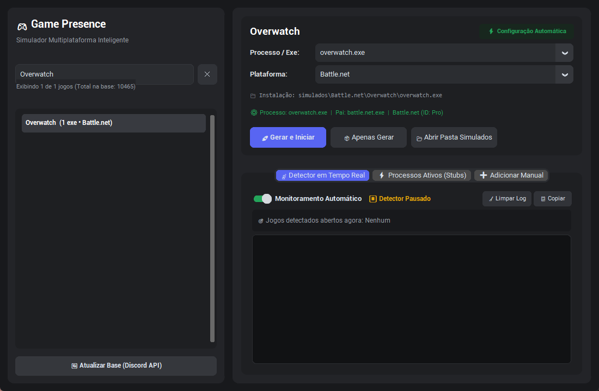
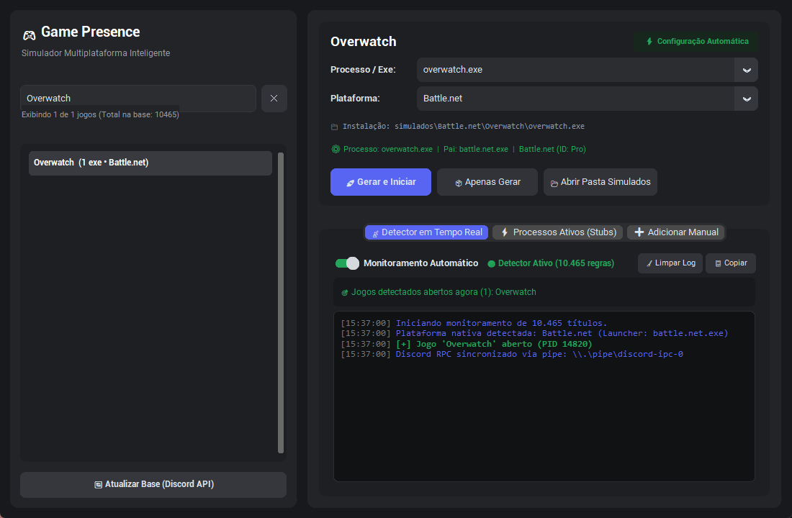
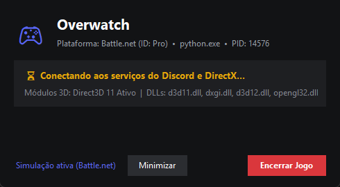
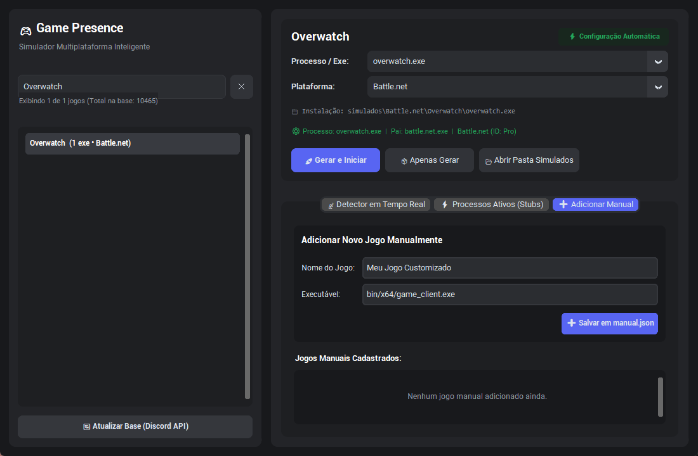

# 🎮 Game Presence Simulator & Detector (Pro Edition)

> **Simulador & Detector Autônomo de Presença de Jogos com Discord Rich Presence Nativo, Contexto Direct3D 11, Spoofing de Processo Pai e Suporte Inteligente Multiplataforma.**


---

## 📸 Galeria do Projeto

### 1. Painel Principal & Seleção Inteligente de Jogos
Interface escura, moderna e fluida desenvolvida em **CustomTkinter**, com busca instantânea sem sensibilidade a acentos e seleção 100% automática da plataforma e executável correto.



---

### 2. Detector de Jogos em Tempo Real
Motor multithread assíncrono que varre processos ativos no Windows a cada 2.5 segundos, exibindo status visual, log colorido com timestamps e aviso imediato de jogos abertos ou fechados.



---

### 3. Jogo Simulado em Execução (Stub Avançado)
Janela do jogo simulado com título nativo Win32, contexto de hardware Direct3D 11 ativo, alocação de memória realista e sincronização com o Discord via IPC Pipe nativo (`\\.\pipe\discord-ipc-0`).



---

### 4. Cadastro Manual de Jogos Customizados
Aba dedicada para adicionar jogos personalizados ou executáveis não listados, persistindo automaticamente no arquivo `manual.json`.



---

## ✨ Principais Funcionalidades

### 🎯 1. Seleção 100% Automática
Basta digitar o nome ou clicar em qualquer um dos **10.465 jogos**:
- **Plataforma Nativa Automática**:
  - Blizzard (*Overwatch, Diablo, World of Warcraft, StarCraft*) $\rightarrow$ **Battle.net** (`battle.net.exe`).
  - Epic Games (*Fortnite, Fall Guys, Rocket League*) $\rightarrow$ **Epic Games Store** (`epicgameslauncher.exe`).
  - Valve & PC (*Counter-Strike 2, Dota 2, GTA V*) $\rightarrow$ **Steam** (`steam.exe`).
  - Ubisoft (*Rainbow Six, Far Cry, Assassin's Creed*) $\rightarrow$ **Ubisoft Connect** (`upc.exe`).
  - Microsoft Store / Xbox $\rightarrow$ **Xbox App** (`gamelaunchhelper.exe`).
- **Ranking Inteligente de Executáveis**:
  - Elimina automaticamente servidores dedicados (`*server*`), crash-reporters, updaters, instaladores e versões de teste (`_ptr_`, `_beta_`, `_test_`, `_be.exe`).
  - Prioriza clientes de 64-bit oficiais (`_retail_/wow-64.exe`, `fortniteclient-win64-shipping.exe`, `win64/cs2.exe`, `overwatch.exe`).

### ⚡ 2. Simulação de Ambiente Ultra-Realista
- **Processo Pai (Parent Process Spoofing)**: O jogo simulado é disparado utilizando as estruturas Win32 `PROC_THREAD_ATTRIBUTE_PARENT_PROCESS` e `EXTENDED_STARTUPINFO_PRESENT`, fazendo o Windows e detectores reconhecerem o launcher oficial como processo pai verídico.
- **Contexto Gráfico Direct3D 11 Hardware**: Inicializa um contexto DirectX real (`D3D11CreateDevice`) e carrega bibliotecas gráficas fundamentais (`d3d11.dll`, `dxgi.dll`, `d3d12.dll`, `vulkan-1.dll`, `opengl32.dll`, `xinput1_4.dll`), ativando os hooks de overlay do Discord.
- **Discord Rich Presence Nativo**: Comunicação direta via pipes locais do Discord com o Client ID oficial de cada título. O Discord exibe imediatamente **"Jogando <Nome do Jogo>"** no status de atividade, com ícone oficial e contagem de tempo.
- **Pastas Oficiais de Instalação**: Gera toda a hierarquia sob a pasta `simulados/`, incluindo metadados como `steam_appid.txt`, `.build.info`, `.egstore/` e `game_settings.ini`.

### 📦 3. Portabilidade Total (Zero Dependências)
- **Executável Único**: `SimuladorPresencaJogos.exe` é 100% autônomo, contendo o `stub.exe`, a base de dados completa de 10.465 jogos e o ícone de alta resolução integrados.
- **Sem Instalação de Python**: Funciona diretamente em qualquer Windows 10/11 x64.
- **Localização Estrita**: Todos os arquivos gerados ficam organizados na raiz onde o executável se encontra (pasta `simulados/` e `manual.json`).

---

## 🚀 Como Usar

### Opção A: Executável Portátil (Recomendado)
1. Dê um duplo clique em [`SimuladorPresencaJogos.exe`](SimuladorPresencaJogos.exe).
2. Na barra de pesquisa, digite o nome do jogo desejado.
3. O executável principal e a plataforma nativa serão selecionados automaticamente.
4. Clique no botão **"🚀 Gerar e Abrir"**.
5. O jogo simulado abrirá com suporte gráfico e será reconhecido pelo Discord em tempo real!

### Opção B: Execução via Código-Fonte (Python)
Caso queira executar ou modificar os códigos-fonte:
```powershell
# Instale os requisitos
pip install customtkinter psutil pillow

# Inicie o aplicativo
python app.py
```
*Ou simplesmente execute o script `iniciar.bat`.*

---

## 📁 Estrutura de Arquivos

```text
Nova pasta (2)/
│
├── SimuladorPresencaJogos.exe   # Executável principal Standalone (Pronto para uso)
├── stub.exe                     # Executável do simulador gráfico e Discord RPC
│
├── app.py                       # Código-fonte da interface CustomTkinter e Motor
├── stub.py                      # Código-fonte do stub (DirectX 11 + Discord RPC)
├── detector.py                  # Motor em segundo plano de detecção de processos
├── baixar_base.py               # Utilitário para atualização da base
│
├── jogos.json                   # Catálogo completo com 10.465 jogos e plataformas
├── manual.json                  # Banco de dados de jogos customizados adicionados
├── app_icon.ico                 # Ícone gamer multi-resolução do aplicativo
│
├── assets/                      # Imagens e capturas de tela do projeto
│   ├── screenshot_main.png
│   ├── screenshot_detector.png
│   ├── screenshot_stub.png
│   └── screenshot_manual.png
│
├── simulados/                   # Diretório de estruturas de instalação geradas
│   ├── Battle.net/
│   ├── Epic Games/
│   └── Steam/
│
└── README.md                    # Documentação oficial do projeto
```

---

## 🛠️ Tecnologias e Bibliotecas

- **Interface Gráfica**: [CustomTkinter](https://customtkinter.tomschimansky.com/) (Dark Mode Moderno)
- **Manipulação de Telas**: [Pillow (PIL)](https://python-pillow.org/)
- **Integração com o Windows**: `ctypes` (Win32 API: `kernel32`, `user32`, `d3d11`, `gdi32`)
- **Monitoramento de Processos**: [psutil](https://github.com/giampaolo/psutil)
- **Protocolo Discord**: IPC Named Pipe (`\\.\pipe\discord-ipc-0` a `9`)
- **Compilação**: [PyInstaller](https://pyinstaller.org/)
